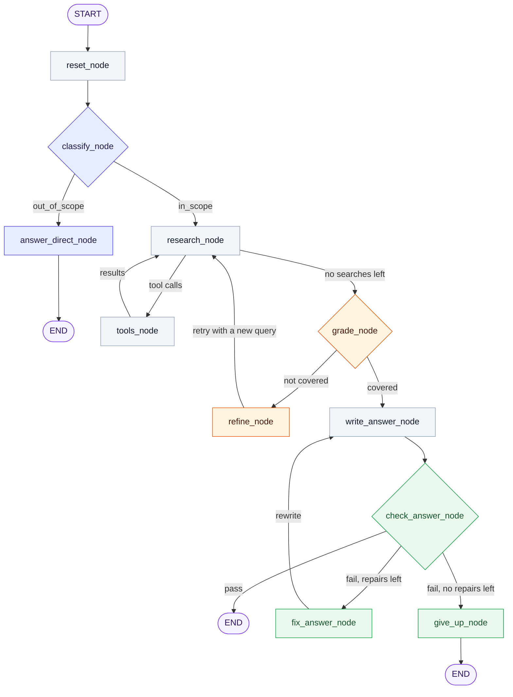

# Agentic RAG

An agentic retrieval-augmented generation system built with **LangGraph**, implementing
three RAG techniques in a single graph over a fixed corpus of two blog posts.

| Technique | What it does | Nodes |
|---|---|---|
| **Adaptive RAG** | Decides whether the question needs retrieval at all | `classify_node` → `answer_direct_node` |
| **Corrective RAG** | Judges whether the retrieved evidence is sufficient, and re-searches with a better query if not | `grade_node` → `refine_node` |
| **Self-RAG** | Verifies the final answer against the retrieved chunks, repairs it, or abstains | `check_answer_node` → `fix_answer_node` / `give_up_node` |

## Flow



Every gate is a separate node, so each step is independently observable and
traceable via LangSmith.

## How it works

1. **Classify** — an LLM decides if the question is in scope and which post it targets
   (`harness-engineering` or `diffusion-models`). Out-of-scope questions skip retrieval
   entirely and get a short "outside the indexed posts" answer.
2. **Research** — a ReAct loop where the LLM calls `retrieve_relevant_document`
   (Pinecone semantic search, `k=5`, optional per-post metadata filter), up to
   **4 searches per round**.
3. **Grade** — a critic LLM checks whether the gathered evidence actually covers the
   question and, if not, names what is missing and proposes one better query.
   Up to **2 corrective rounds**, then it writes the best answer it can.
4. **Write** — the answer is composed strictly from the retrieved chunks, using the
   author's own wording for definitions.
5. **Check** — a verifier LLM confirms every claim in the answer is supported by the
   chunks (and catches claims credited to the wrong post). Up to **2 repairs**, then the
   system **declines** rather than guessing.

### Loop budgets

| Limit | Value | Resets when |
|---|---|---|
| `MAX_SEARCHES` | 4 | `refine_node` starts a new round |
| `MAX_CORRECTIVE_ATTEMPTS` | 2 | — |
| `MAX_REPAIRS` | 2 | — |

Worst case: 3 research rounds × 4 searches = 12 search turns.

## Corpus

Two posts, ingested by `ingestion.py` (scrape → chunk `1000/200` → embed → Pinecone,
1536-dim, cosine, `aws/us-east-1`):

- **harness-engineering** — *Harness Engineering for Self-Improvement* (Lilian Weng, 2026)
- **diffusion-models** — *Diffusion Models for Video Generation* (Lilian Weng, 2024)

## Evaluation with DeepEval

The quality gates (`classify`, `grade`, `check_answer`) are LLM judgments, so the system
is measured with an independent judge instead of eyeballing answers. `evals/` holds a
golden dataset and a runner that scores every graph run with
[DeepEval](https://github.com/confident-ai/deepeval).

### Golden dataset — `evals/goldens.json`

20 hand-written cases, each with an `input` and an `expected_output`:

| Bucket | Cases | What it covers |
|---|---|---|
| Answerable — `harness-engineering` | 6 | harness definition, ACE/MCE, Meta-Harness, STOP, Self-Harness |
| Answerable — `diffusion-models` | 7 | v-prediction, Imagen Video, Make-A-Video, Text2Video-Zero, Video LDM vs SVD |
| Refusal — detail not in the corpus | 5 | e.g. Sora's parameter count, AlphaEvolve compute, SVD dataset size |
| Refusal — false cross-post premise | 1 | "How does the harness post use diffusion models?" |
| Refusal — out of scope | 1 | "Who won the 2022 FIFA World Cup?" |

The 13 answerable cases exercise retrieval + writing. The 7 refusal cases exercise
`give_up_node` and the "don't guess" contract; their `expected_output` is the literal
sentinel `"DECLINE"`.

### Metrics

Each case is built from the final graph state — `answer` becomes `actual_output`, the
retrieved `chunks` become `retrieval_context` — then measured with five metrics, all
judged by `gpt-4o-mini`:

| Metric | Threshold | Inputs used | Catches |
|---|---|---|---|
| **Faithfulness** | 0.80 | question, answer, chunks | claims the chunks do not support (hallucination) |
| **Answer Relevancy** | 0.70 | question, answer | answers that dodge or drift off the question |
| **Contextual Recall** | 0.70 | question, expected answer, chunks | retrieval missing evidence the golden answer needs |
| **Contextual Precision** | 0.60 | question, expected answer, chunks | relevant chunks ranked below noise |
| **Contextual Relevancy** | 0.50 | question, chunks | retrieval full of off-topic chunks |

The thresholds split into two families: **generation** (Faithfulness, Answer Relevancy)
and **retrieval** (the three Contextual metrics). That split is what makes a failure
actionable.

### Running

```bash
uv run python -m evals.test_rag
```

`python -m` (not a file path) is required so the repo root stays on `sys.path` and
`from graph import graph` resolves. Each run prints PASS/FAIL, the score, the judge cost,
and the reason for every failed metric:

```
Question: 1
Faithfulness: PASS
Score: 0.92
Cost: $ 0.000412
------------------------------------------------------------
```

> `evals/test_rag.py` is a **runner script**, not a pytest module: it defines no
> `test_*` functions, so `deepeval test run` / `pytest` would collect zero tests. Use
> the command above. It also evaluates only the first 4 goldens
> (`dataset.goldens[0:4]`) — drop the slice to run all 20.

### Reading the results

| Symptom | Likely cause | Where to fix |
|---|---|---|
| Faithfulness low | writer adds outside knowledge or ignores chunks | `WRITE_ANSWER_SYSTEM` |
| Answer Relevancy low | answer is accurate but not what was asked | `WRITE_ANSWER_SYSTEM`, `CLASSIFY_SYSTEM` |
| Contextual Recall low | chunks lack the facts | chunking, `k=5`, `refine_node` queries, ingestion |
| Contextual Precision low | good chunks buried under noise | `k`, metadata filter, duplicate chunks across rounds |
| Contextual Relevancy low | retrieval returns off-topic chunks | query wording, per-post `blog_post` filter |

### Cost

Every case runs the full graph *plus* five judge calls; the runner prints per-metric cost
so a full 20-case run can be budgeted.

## Stack

Python 3.12 · LangGraph · LangChain · Pinecone · DeepEval · OpenAI (`gpt-4o-mini` for
reasoning and judging, `text-embedding-3-small` for retrieval) · uv

## Project layout

| File | Role |
|---|---|
| `graph.py` | Compiles the `StateGraph`; exported as `graph` for `langgraph.json` |
| `state.py` | `AgenticGraphState` — 14 keys, `messages` uses the `add_messages` reducer |
| `nodes.py` | All 11 nodes + Pydantic schemas for structured output |
| `edges.py` | The 4 routing functions and the loop limits |
| `prompts.py` | Every system prompt (`CLASSIFY`, `RESEARCH`, `GRADE`, `WRITE_ANSWER`, `CHECK_ANSWER`, `ANSWER_DIRECT`, `GIVE_UP_MESSAGE`) |
| `tools.py` | `retrieve_relevant_document` — Pinecone semantic search tool |
| `ingestion.py` | Standalone script that builds the index |
| `llm_model.py` | The shared `gpt-4o-mini` client |
| `evals/goldens.json` | 20 golden cases: 13 answerable, 7 refusal (`"DECLINE"`) |
| `evals/test_rag.py` | DeepEval runner: 5 metrics scored against the graph's answer + chunks |
| `docs/graph_annotated.png` | Annotated architecture diagram |

## Quick start

```bash
uv sync
cp .env.example .env        # add your keys
uv run python ingestion.py  # scrape, chunk and embed the two posts
uv run langgraph dev        # open LangGraph Studio
uv run python -m evals.test_rag  # score the graph with DeepEval
```

To run it from Python instead:

```python
from graph import graph

result = graph.invoke({"question": "What are the three components of ACE?"})
print(result["answer"])
```

## Configuration

| Variable | Purpose |
|---|---|
| `OPENAI_API_KEY` | Chat completions and embeddings |
| `PINECONE_API_KEY` | Vector store |
| `INDEX_NAME` | Pinecone index name (default `agentic-rag-index`) |
| `LANGSMITH_*` | Optional tracing |

> `ingestion.py` **deletes the existing index contents** when re-run.
